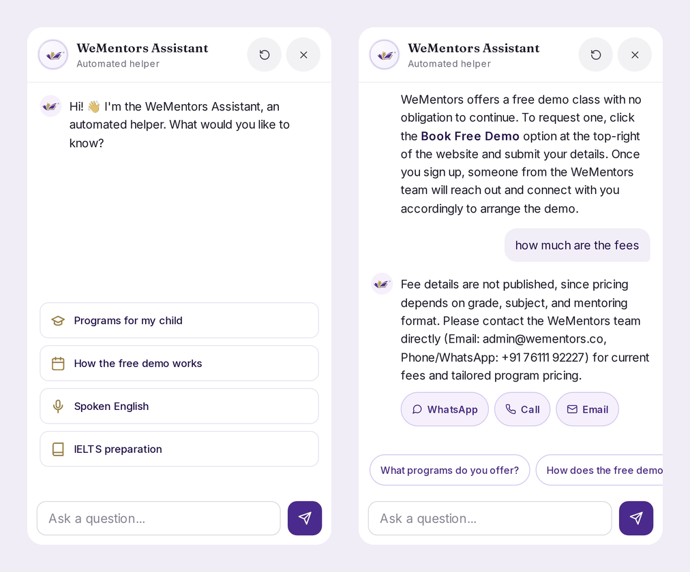
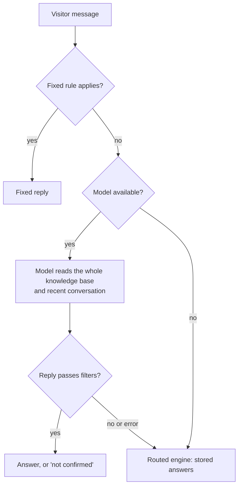

# WeMentors Assistant

[](https://github.com/raaixd/wementorschatbot/actions/workflows/ci.yml)


The chat assistant on the [WeMentors](https://wementors.vercel.app) website. It answers parents' and students' questions about programs, classes and demo bookings from a curated knowledge base, and points them to the team when it has no confirmed answer.

**[Live site](https://wementors.vercel.app)**



## Features

- **Grounded answers** from a 54-entry knowledge base, with a fixed "not confirmed" reply when the model cannot find the fact
- **Fixed safety replies**, written in code, for possible self-harm, a distressed child, additional needs, child safety, data privacy, mentor personal details, outcome guarantees and "are you a real person?"
- **Output filters** that block false booking claims, prices, unknown phone numbers or emails, and promised results
- **Works without a model:** if the model fails or no key is set, stored answers are used
- **Mobile-friendly chat window** with welcome cards, WhatsApp, call and email buttons, and reduced-motion support
- **No fake bookings:** the assistant never claims to have booked anything. Visitors use the demo form or contact the team

## How It Answers



The default, `ANSWER_MODE=full_kb`, sends the whole knowledge base (about 4,500 tokens) with each model call. `ANSWER_MODE=routed` instead uses keyword routing and retrieval to choose what the model sees. The routed engine is also the backup, and it does not call the model a second time after a failure.

### Why the whole knowledge base

Both designs answered the same informal, multi-turn parent questions, including traps meant to draw a false "yes". Answers were graded pass or fail without labels.

| Design | Round 1 | Round 2 | Total |
|---|---:|---:|---:|
| Routing and retrieval, then the model | 30/43 | 20/35 | **50/78 (64%)** |
| Fixed rules, then the model with the whole knowledge base | 37/43 | 32/35 | **69/78 (88%)** |

**Limits:** the questions were written and graded during development by the same party that made the change. They were not collected from real parents or graded independently, and the two styles are sometimes recognisable. Treat the result as a strong hint, and repeat it on real questions with the [comparison tool](evaluation/runners/compare_real_questions.py).

## Quick Start

```bash
git clone https://github.com/raaixd/wementorschatbot.git
cd wementorschatbot

python -m venv .venv
source .venv/bin/activate          # Windows: .venv\Scripts\activate
pip install -r backend/requirements.txt

cp backend/.env.example backend/.env    # optional: add a model key
cd backend
python -m uvicorn app.main:app --reload
```

Open <http://127.0.0.1:8000> for the website and chat. API docs are at `/docs`.

## Configuration

Settings are read from `backend/.env`. See [`.env.example`](backend/.env.example) for the full list.

| Variable | Default | Purpose |
|---|---|---|
| `GEMINI_API_KEY` | empty | Enables Gemini. Groq and Anthropic keys also work |
| `ANSWER_MODE` | `full_kb` | `full_kb` or `routed` |
| `HYBRID_RETRIEVAL_ENABLED` | `false` | Adds embedding search to the routed engine |
| `RATE_LIMIT_MAX_REQUESTS` | `20` | Requests per client per window |
| `ADMIN_API_KEY` | empty | Enables `/admin/analytics` |

## API

| Method | Path | Purpose |
|---|---|---|
| `GET` | `/health` | Status, knowledge base size and active model |
| `POST` | `/chat` | Send a message |
| `POST` | `/chat/clear` | Clear a conversation |
| `POST` | `/feedback` | Rate a reply |
| `GET` | `/admin/analytics` | Usage summary (needs the admin key) |

## Development

```bash
SKIP_DOTENV=1 pytest              # 375 tests; SKIP_DOTENV stops them calling a real model
ruff format . && ruff check .     # formatting and lint, also run in CI
```

Tests without a real model do not show how one behaves. Before changing prompts or answer logic, also try the change with a key set.

### Updating the knowledge base

1. Edit [`knowledge/wementors_kb.json`](knowledge/wementors_kb.json).
2. Regenerate the embeddings with `python scripts/generate_kb_embeddings.py` (needs `GEMINI_API_KEY` in the environment).
3. Run the tests.

Facts still waiting on the team are listed in [Open Questions](docs/OPEN_QUESTIONS.md).

## Project Structure

```
├── index.html              Website and chat window
├── api/index.py            Vercel entry point
├── backend/
│   ├── app/
│   │   ├── main.py         API routes
│   │   ├── conversation.py Answer pipeline and routed engine
│   │   ├── policy.py       Fixed safety rules
│   │   ├── llm.py          Model providers, prompts and output filters
│   │   ├── scope.py        What may be answered with "yes"
│   │   ├── presentation.py Final wording and fallbacks
│   │   ├── retrieval.py    Lexical and hybrid search
│   │   └── ...             Config, database, rate limiting, embeddings
│   └── tests/
├── knowledge/              Knowledge base and embeddings
├── evaluation/             Benchmarks and the comparison tool
└── scripts/                Embedding generation and feedback export
```

## Retrieval Benchmark

These figures describe the routed engine's search step, on 156 queries. They come from the committed [report](evaluation/reports/conditional_hybrid_benchmark_report.md), which predates the fixes of 26 November 2026 and has not been rerun.

| Metric | Lexical | Hybrid |
|---|---:|---:|
| Recall@1 | 72.00% | 76.00% |
| MRR | 0.7733 | 0.8000 |
| Answer correctness | 78.85% | 82.69% |
| False positive rate | 0.0% | **60.0% (worse)** |
| In-memory retrieval latency | 8.81 ms | 10.22 ms (worse) |

The false positive rate rests on only 5 negative cases (3 of 5), too few to measure it well. "Correct" means at least half of the expected keywords appeared, not a human judgement. The separate [lexical baseline](evaluation/reports/baseline_report.md) misses its targets for intent accuracy (35.71% against 90%), answer correctness and unknown-question handling.

## Deployment

Pushes to `main` deploy to Vercel. Set the model key in the Vercel project settings. Pull requests get a preview build.

## Known Limitations

- On Vercel, conversation history is stored in `/tmp`. It is not shared between instances or kept across restarts, so follow-up questions can lose context.
- The rate limiter is in memory, per instance.
- Safety rules match set phrases and cannot catch every way of saying something.
- Session IDs are bearer values. There is no other authentication.
- `conversation.py`, the routed engine, is large and relies heavily on pattern matching.

## License

No license file is included.
